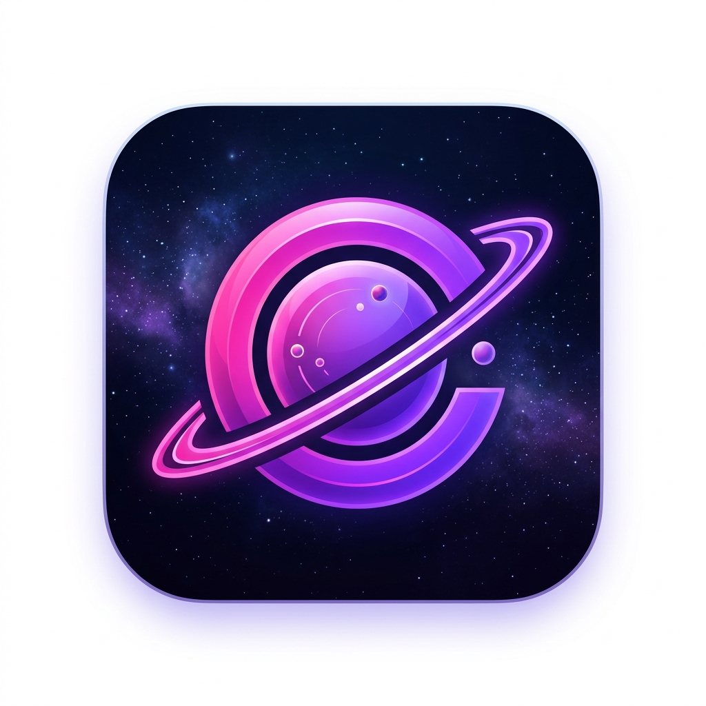
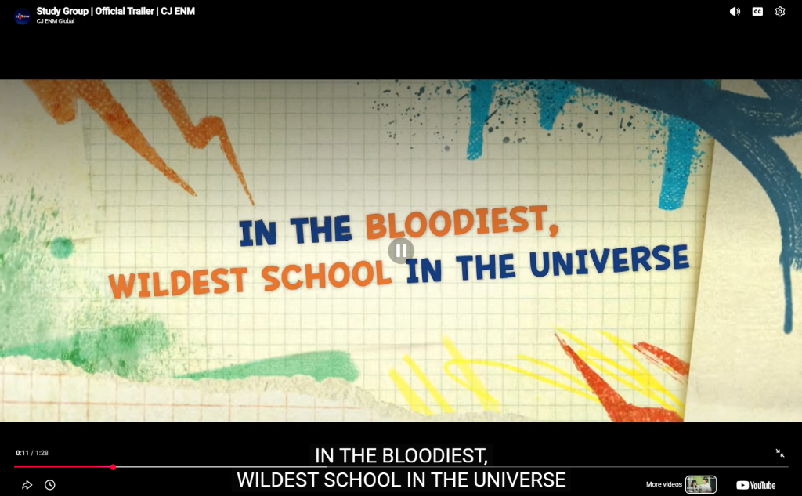
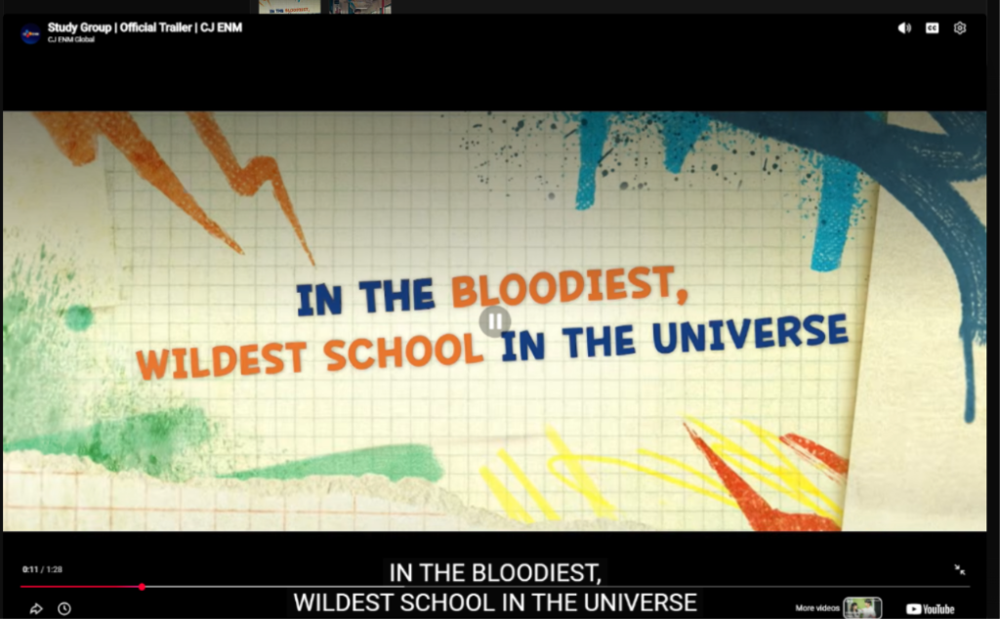
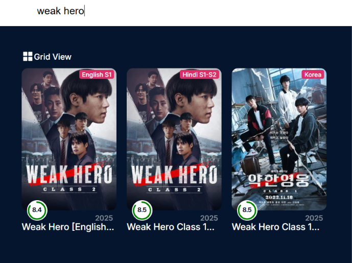
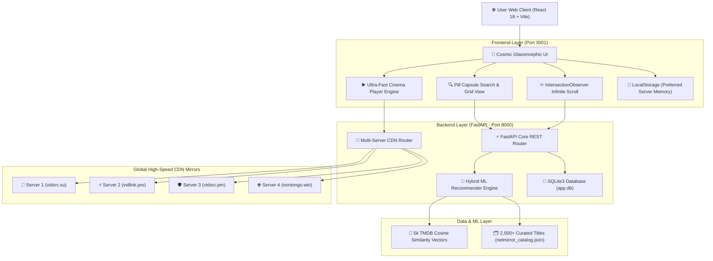
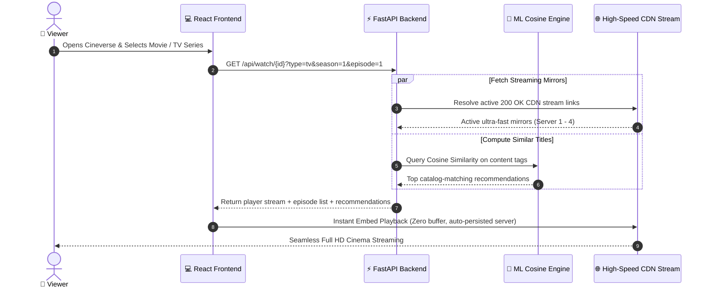

# 🌌 Cineverse — Your Universe of Entertainment

<div align="center">
  
  
  <br/><br/>

  <h1>C I N E V E R S E</h1>
  <p><b>Next-Generation Cinema & TV Series Streaming Platform with Hybrid ML Recommendations</b></p>

  [](https://www.python.org/)
  [](https://fastapi.tiangolo.com/)
  [](https://react.dev/)
  [](https://vitejs.dev/)
  [](#machine-learning-recommendation-engine)
  [](#streaming-architecture)
  [](LICENSE)
</div>

---

## 📸 Platform Showcase & Previews

<div align="center">
  <h3>🎬 Immersive Multi-Server Cinema Player & Episode Selector</h3>
  
  <br/><br/>
  
  <table width="100%">
    <tr>
      <td width="50%" align="center">
        <b>📺 Multi-Season & Multi-Episode Hub</b><br/><br/>
        
      </td>
      <td width="50%" align="center">
        <b>🔍 Dedicated Grid Search & Card Previews</b><br/><br/>
        
      </td>
    </tr>
  </table>
</div>

---

## 🏛️ System Architecture Diagram



---

## 🔄 User Playback & Recommendation Flow



---

## 📂 Project Directory Structure

```text
cineverse/
├── 📁 backend/                        # High-Performance FastAPI Backend
│   ├── main.py                       # RESTful API endpoints, shelves & proxy
│   ├── streaming_service.py          # Multi-server CDN router & failover logic
│   ├── recommender.py                # Hybrid Cosine Similarity ML recommendation engine
│   └── database.py                   # SQLite Watchlist, History & Resume playback
│
├── 📁 frontend/                       # Modern React 18 Single Page Application
│   ├── 📁 public/                    # High-res brand logos, SVGs & favicons
│   │   ├── cineverse-card.png        # Official 1024x1024 cosmic squircle card
│   │   ├── cineverse-logo.png        # Isolated transparent C-O Saturn logo
│   │   ├── cineverse-card.svg        # Scalable vector card format
│   │   ├── cineverse-logo.svg        # Scalable vector logo format
│   │   └── favicon.png               # Browser tab icon
│   ├── 📁 src/
│   │   ├── 📁 components/            # Reusable UI modules
│   │   │   ├── Navbar.jsx            # Pill capsule search bar & instant recommendations
│   │   │   ├── MovieCard.jsx         # Card badges, circular ratings & release year
│   │   │   ├── VideoPlayer.jsx       # Multi-server video player with error boundary
│   │   │   ├── HeroBanner.jsx        # Spotlight cinema hero slider
│   │   │   └── MovieShelf.jsx        # Horizontal scrolling shelves
│   │   ├── 📁 pages/                 # Route views
│   │   │   ├── HomePage.jsx          # Infinite Scroll feed & country filters
│   │   │   ├── WatchPage.jsx         # Full player, seasons/episodes selector & cast
│   │   │   ├── SearchPage.jsx        # Dedicated full-page grid search
│   │   │   ├── WatchlistPage.jsx     # Saved titles
│   │   │   └── HistoryPage.jsx       # Resume playback progress
│   │   └── 📁 services/
│   │       └── api.js                # Frontend API client
│   ├── index.html                    # Root HTML5 template
│   └── vite.config.js                # Vite build configuration
│
├── 📁 docs/
│   └── 📁 images/                    # UI screenshots & showcase previews
│       ├── player-preview.png
│       ├── episodes-preview.png
│       ├── browse-preview.png
│       └── search-cards-preview.png
│
├── 📄 netmirror_catalog.json          # Curated 2,500+ authentic movies & TV series
├── 📄 Movie-Recommendation-System.ipynb # ML Training & exploratory analysis notebook
├── 📄 START_CINEVERSE.bat             # 1-Click launcher for Windows
├── 📄 requirements.txt                # Python backend dependencies
├── 📄 Procfile                        # Production process configuration
├── 📄 setup.sh                        # Deployment shell script
└── 📄 README.md                       # Documentation & Project Guide
```

---

## ⚡ Key Highlights & Capabilities

| Capability | Implementation | Benefit |
| :--- | :--- | :--- |
| **Instant Streaming** | Top-ranked verified mirrors (`vidsrc.su`, `vidlink.pro`, `vidsrc.pm`, `nontongo`) | Zero "refused to connect" errors; instant 1-click playback |
| **TV Series Tracking** | Dynamic Season & Episode mapping with authentic episode stills | Real-time multi-season navigation for global & regional series |
| **Hybrid ML Recommender** | Content-based Cosine Similarity vectors mapped to curated catalog | Guaranteed authentic posters & ratings with zero generic fallbacks |
| **Infinite Continuous Feed** | `IntersectionObserver` with advance 400px rootMargin pre-loading | Eliminates manual "Load More" buttons for frictionless browsing |
| **Persistent Memory** | `localStorage` server persistence + SQLite playback history | Never lose your chosen server or watched minutes |

---

## 🚀 Quick Start & Installation Guide

Get **Cineverse** up and running on your local machine in under 2 minutes!

### 📋 Prerequisites

Before getting started, make sure you have the following installed on your machine:
- **Python 3.10+** — [Download Python](https://www.python.org/downloads/) (Make sure to check *"Add Python to PATH"* during installation)
- **Node.js (v18 or higher)** & **npm** — [Download Node.js](https://nodejs.org/)
- **Git** — [Download Git](https://git-scm.com/)

---

### ⚡ Option 1: 1-Click Auto Launcher (Windows — Recommended)

No manual terminal commands needed! We provide a pre-configured automation script that boots both full-stack services and opens your browser:

1. Clone or download the repository to your PC.
2. In the root directory, simply double-click on:
   ```cmd
   START_CINEVERSE.bat
   ```
3. What happens automatically:
   - 📡 Boots the **FastAPI Backend server** on `http://127.0.0.1:8000`
   - ⚡ Boots the **Vite + React Frontend** on `http://localhost:3001`
   - 🌐 Automatically launches Cineverse in your default browser!
   - 💡 *Keep the launcher window open or minimized while streaming.*

---

### 💻 Option 2: Step-by-Step Manual Setup (Cross-Platform)

Follow these clear, step-by-step instructions for Windows, macOS, or Linux.

#### Step 1: Clone the Repository
Open your terminal (PowerShell, Bash, or Command Prompt) and run:
```bash
git clone https://github.com/aashutoshkumarr/cineverse.git
cd cineverse
```

---

#### Step 2: Configure & Start the Python Backend

Open a terminal in the project root:

1. **Create an isolated Virtual Environment**:
   ```bash
   python -m venv venv
   ```

2. **Activate the Virtual Environment**:
   - **Windows (PowerShell / Command Prompt)**:
     ```powershell
     .\venv\Scripts\activate
     ```
   - **macOS / Linux**:
     ```bash
     source venv/bin/activate
     ```

3. **Install Backend Dependencies**:
   ```bash
   pip install --upgrade pip
   pip install -r requirements.txt
   ```

4. **Run the FastAPI Server**:
   ```bash
   uvicorn backend.main:app --host 127.0.0.1 --port 8000 --reload
   ```
   > 🟢 **Backend status:** Running at `http://127.0.0.1:8000`  
   > 📑 **Interactive API Docs (Swagger):** `http://127.0.0.1:8000/docs`

---

#### Step 3: Configure & Start the React Frontend

Open a **new separate terminal window** and navigate into the `frontend` folder:

1. **Navigate to Frontend directory**:
   ```bash
   cd frontend
   ```

2. **Install Node Packages**:
   ```bash
   npm install
   ```

3. **Launch the Vite Development Server**:
   ```bash
   npm run dev -- --port 3001 --host 0.0.0.0
   ```
   > 🟢 **Frontend status:** Ready in ~200ms!

---

#### Step 4: Open & Enjoy Cineverse!

Open any web browser (Chrome, Edge, Brave, Safari, Firefox) and paste:
👉 **[http://localhost:3001](http://localhost:3001)**

> 📱 **Streaming from phone on same Wi-Fi?**  
> Vite prints your local network IP (e.g., `http://192.168.x.x:3001`). Simply open that URL on your phone or tablet connected to the same Wi-Fi!

---

## 🔧 Environment & Port Reference

| Service | Host | Port | Endpoint URL | Description |
| :--- | :--- | :--- | :--- | :--- |
| **Vite Frontend** | `localhost` | `3001` | `http://localhost:3001` | Single-Page Application & Cinema UI |
| **FastAPI Backend** | `127.0.0.1` | `8000` | `http://127.0.0.1:8000` | REST API, Streaming Router & Proxy |
| **API Docs (Swagger)** | `127.0.0.1` | `8000` | `http://127.0.0.1:8000/docs` | Interactive API documentation |
| **Local Database** | Local SQLite | — | `backend/app.db` | Watchlist, Watch History & Timestamps |

---

## 🤝 Contributing

Contributions, issues, and feature requests are welcome!  
Feel free to check out the [issues page](https://github.com/aashutoshkumarr/cineverse/issues) if you want to contribute.

1. Fork the Project
2. Create your Feature Branch (`git checkout -b feature/AmazingFeature`)
3. Commit your Changes (`git commit -m 'Add some AmazingFeature'`)
4. Push to the Branch (`git push origin feature/AmazingFeature`)
5. Open a Pull Request

---

## 📄 License

This project is licensed under the **MIT License** — see the [LICENSE](LICENSE) file for details.

---

<div align="center">
  <sub>Built with ❤️ by <a href="https://github.com/aashutoshkumarr">Ashutosh Kumar</a>. Powered by FastAPI, React & Machine Learning.</sub>
</div>
